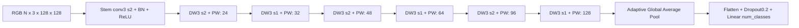
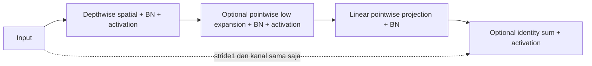

# Arsitektur GumiNet V1 dan V2

Status: experimental research project. Defaults/factory lama dipertahankan. Opsi baru
bersifat opt-in dan bukan V3. Hasil Intel pengguna bukan hasil reproduksi engineering.

## V1



Setiap DW/PW pada V1 diikuti BatchNorm dan ReLU. Conv tanpa bias. Depthwise memakai
satu filter spasial per input channel (groups=channels), sedangkan pointwise1×1 mencampur
kanal. BN menormalisasi statistik batch/spasial dengan gamma/beta trainable; saat eval
memakai running statistics. Accumulation tidak memperbesar microbatch BN.
ReLU meniadakan nilai negatif; LeakyReLU0.1 adalah alternatif opt-in.

| Titik Tiny | Shape (N=1, input128) |
|---|---|
| input | 1×3×128×128 |
| stem | 1×16×64×64 |
| stage0 | 1×24×32×32 |
| stage1 | 1×32×32×32 |
| stage2 | 1×48×16×16 |
| stage3 | 1×64×16×16 |
| stage4 | 1×96×8×8 |
| stage5 | 1×128×8×8 |
| GAP | 1×128×1×1 |
| classifier | 1×num_classes |

Downsampling total16 mengurangi komputasi dan aktivasi, dengan potensi kehilangan detail
yang perlu diuji. GAP merata-ratakan tiap kanal sehingga head tidak terikat resolusi
spasial. Default160, preset128/160/192/224; input lain kompatibel selama syarat operator/BN
terpenuhi. Width dibulatkan ke kelipatan4 minimum4; Small depth2, Nano/Tiny depth1.

## V2



Expansion1.0 melewati mixing tambahan; 1.5 menambah hidden channels. Tidak ada attention,
SE atau operator CUDA khusus. Residual identity tidak menambah parameter, tetapi mengubah
jalur gradien. Shortcut projection otomatis tidak ditambahkan saat kanal/stride berbeda.
`projection_activation: post` mempertahankan perilaku lama. `pre` mengaktifkan proyeksi
sebelum sum, `linear` tanpa aktivasi proyeksi. Keduanya opsi eksperimen terpisah.

**Kesetaraan penting:** V2 D1/expansion1 tanpa identity sama fungsi DW/BN/ReLU/PW/BN/ReLU
seperti V1 width sama. Test forward/input-gradient identik setelah leaf weights dipetakan.
Names state_dict berbeda; ini bukan izin load checkpoint V1 sebagai V2 secara sembarang.
Pada depth1 default, flag residual saja tidak membuat skip aktif karena semua kanal berubah.
Pada V2 Residual lama depth2, ada enam identity aktif.

## Refinement opt-in

- V1: `kernel_size=5`, `activation="leaky_relu"`, custom `channels`/`strides`.
- `v2_refined_d1_w075`: depth1, width0.75, expansion1, tanpa residual; preset historis.
- `v2_candidate_stage3`: stage_depths [1,1,1,2,1,1], width0.75, residual_stages [3].
  Indeks stage nol: sesudah stage keempat ditambah blok48→48 stride1, satu skip aktif.
  Output kandidat: stem12×64² →16×32² →24×32² →36×16² →48×16² →48×16²
  →72×8² →96×8² →GAP→classifier. Ini perubahan struktur yang dapat diuji, bukan klaim novelty.
- Kontrol repeat sama dengan `residual=False` memisahkan efek penambahan depth dan skip.
- Lokasi alternatif stage1 memberi jumlah parameter berbeda karena kanal stage berbeda;
  laporkan trade-off, bukan klaim fixed-budget murni.

## Ukuran hasil program

| Registry | Parameters (3 kelas) | Conv/linear MACs (128², batch1) | Identity aktif |
|---|---:|---:|---:|
| v2_refined_d1_w075 | 17,047 | 3,709,728 | 0 |
| v2_candidate_stage3 | 19,975 | 4,410,144 | 1 |
| guminet_v1 | 28,907 | 5,953,920 | 0 |
| guminet_nano | 8,407 | 2,092,224 | 0 |
| guminet_tiny | 28,907 | 5,953,920 | 0 |
| guminet_small | 102,859 | 17,644,000 | 0 |
| guminet_v2_plain | 67,603 | 11,772,288 | 0 |
| guminet_v2_residual | 67,603 | 11,772,288 | 6 |
| guminet_v2_low_expansion | 175,123 | 27,206,016 | 0 |
| guminet_v2_low_expansion_residual | 175,123 | 27,206,016 | 6 |

Angka dihasilkan oleh `model_architecture_summary`, bukan hard-code perhitungan model.
Rincian konfigurasi/feature maps: [architecture_measurements.json](docs/research/architecture_measurements.json).
MACs conv/linear tidak menghitung BN/ReLU/pooling/sum; FLOPs konvensional2×MACs.
Estimated activation bytes adalah jumlah output stem+block, bukan peak live tensor atau RSS.
Gradient/feature statistics dari input acak adalah diagnostik, bukan bukti kualitas fitur.

```python
from guminet import create_model, model_architecture_summary
model = create_model("v2_candidate_stage3", num_classes=3)
report = model_architecture_summary(model, input_size=128, include_gradients=True)
print(report["active_residual_blocks"], report["estimated_macs"])
```

## Checkpoint compatibility

Semua delapan registry lama, constructor default, classifier, state_dict paths dan
default model_config tetap sama. Format_version1 dipertahankan; opsi nondefault saja
menambah keys pada model_config. Loader baru menerima checkpoint lama tanpa opsi atau
metadata experiment. Checkpoint refinement menyimpan opsi eksplisit dan harus dibuka
oleh source yang mendukungnya; jangan menggantinya ke konfigurasi lama diam-diam.
Referensi source v0.1.0 dan regression tests memverifikasi loading strict serta exact
forward parity. Checkpoint Intel asli pengguna belum tersedia untuk uji langsung.

Regenerasi hasil program: `python scripts/measure_architectures.py --output runs/architecture_measurements.json`.
