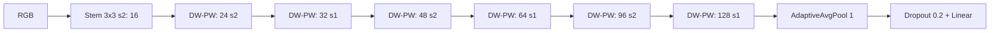

# Arsitektur

V1 merupakan baseline depthwise-separable, bukan klaim novelty. Default RGB 160×160.

Setiap conv V1 diikuti BN dan ReLU; conv tanpa bias. Adaptive pooling mendukung
resolusi lain, termasuk bukan persegi. Resolusi sangat kecil dan batch satu dapat
melanggar syarat statistik BatchNorm saat training; preset 128–224 direkomendasikan.
Width dibulatkan ke kelipatan empat dengan minimum empat kanal.

V2 mempertahankan V1 sebagai model terpisah. Blok V2: depthwise spatial conv + BN/ReLU,
opsional pointwise expansion + BN/ReLU, linear pointwise projection + BN,
opsional identity sum, ReLU. Expansion 1.0 melewati mixing tambahan; 1.5 membuat
intermediate sempit. Residual hanya stride=1 dan kanal input=output.
Empat konfigurasi memakai depth=2 agar blok kedua setiap stage dapat memakai residual.
Plain dan Residual mempunyai parameter sama; perbedaan hanya identity addition.

Factory Nano/Tiny/Small mengubah width/depth. `model.model_config` menyimpan struktur
aktual, bukan hanya alias, sehingga checkpoint dapat direkonstruksi dengan tepat.
Kustomisasi: `create_model("guminet_v2_plain", num_classes=3, width=0.75, depth=1,
strides=[2,1,2,1,2,1], expansion=1.5)`. Jangan menyebut perubahan ini improvement
sebelum training dan benchmark berulang pada dataset nyata.

V1 tidak menggunakan residual, expansion, attention, SE, Transformer, atau custom CUDA.
Tidak ada eksperimen lama dalam checkout awal, sehingga preset original 192 tidak
diada-adakan; gunakan input_size=192 jika ingin mengukur baseline pada resolusi itu.
